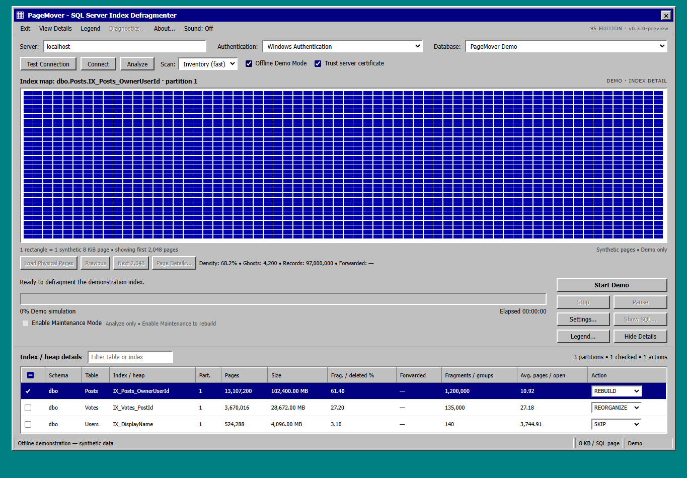

# SQL Server Engineering Portfolio

Selected database engineering projects by **Steven Wittek**, a New Jersey-based senior SQL Server engineer and the creator of **Netherwood Data Partners**.

I work on the problems between application code and production infrastructure: query regressions, large datasets, release safety, observability and recovery. This repository is a **project index**, not a collection of production-certified maintenance scripts.

## QueryVault: preserving Query Store history for long-term performance comparisons

**Problem:** Query Store is useful for tuning, but an older test window may disappear when retention limits are reached or a database is refreshed. That can wipe out the baseline before a team's performance improvements are complete.

**Approach:** Capture selected completed Query Store periods in an independent SQL Server archive with run-level metadata, protection and retention controls. QueryVault exposes the familiar Query Store entities through a reporting layer, including Grafana views for archived periods, comparisons, waits and query detail.

*Actual September 2026 SQL Server lab capture. Not a fabricated performance result.*

**[QueryVault source and documentation](https://github.com/stevewittek/Databases)** · [July-to-October performance-baseline use case](https://github.com/stevewittek/Databases/blob/master/docs/USE_CASES.md) · [Four dashboard screenshots](https://github.com/stevewittek/Databases/blob/master/docs/SCREENSHOT_PLAN.md) · [Validation evidence](https://github.com/stevewittek/Databases/blob/master/docs/VALIDATION_REPORT.md)

## PageMover: SQL Server index and heap analysis with a visual interface

**Problem:** An index maintenance recommendation is more useful when an operator can inspect the affected structures, review the proposed commands and understand what will be changed.

**Approach:** A local ASP.NET Core utility that inspects indexes, heaps, partitions and physical pages. Analysis and maintenance are separate. Maintenance actions require an explicit review and confirmation. The interface borrows its visual language from classic Windows disk defragmentation tools.

*Actual PageMover application screenshot using synthetic demonstration data. The page map and statistics above are a demo, not measurements from a live SQL Server instance.*

**[PageMover design and safety walkthrough](docs/PAGEMOVER_OVERVIEW.md)** · [Product page](https://netherwooddatapartners.com/products/sql-server-index-maintenance-visualizer/)

**Availability:** Developer preview. The implementation repository remains private during the public-release review. This preview does not imply production readiness or distribute the maintenance tool.

## More of my work

**[Netherwood Data Partners](https://netherwooddatapartners.com/about/)**: database engineering, software and data integration projects, with a [public website repository](https://github.com/stevewittek/netherwood-data-partners) and [SQL Server articles](https://netherwooddatapartners.com/articles/).

**[Professional background](https://www.linkedin.com/in/steven-wittek-64956965)**: enterprise SQL Server development, performance tuning, HA/DR, Azure SQL, monitoring, PowerShell and controlled delivery.

### How I approach database engineering

Measure before changing. Preserve a baseline. Review SQL as code. Test with a recoverable plan. Make the outcome verifiable, and write enough documentation that the next engineer can support it.

---

*Maintained by Steven Wittek, Netherwood Data Partners. Project examples and screenshots are identified as either validated lab captures or synthetic demonstrations.*
