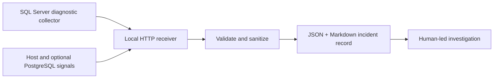
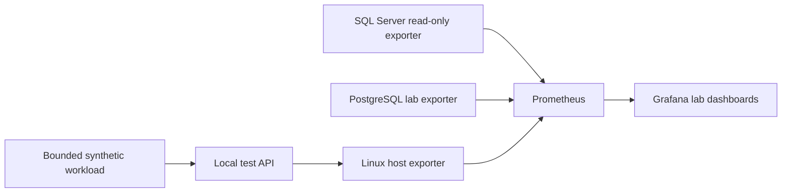

# Database platform and incident engineering labs

**Steven Wittek | Netherwood Data Partners**

These independent labs explore platform reliability and repeatable SQL Server diagnostics. Their full implementation repositories remain **private** while environment-specific details are separated from reusable source. This page documents the engineering approaches without publishing private host inventories, credentials, interview exercises, or customer data.

## 1. Database Incident Lab

A database incident is easier to investigate when evidence is collected while the problem is happening rather than relying entirely on a recollection after recovery.

The lab explores a bounded, local pipeline that collects SQL Server and host diagnostics, validates and redacts fields, and creates structured event records for an engineer to investigate. A downstream assistant can help interpret sanitized evidence but cannot authorize remediation.

**Engineering focus:** SQL Server DMVs, reliable event contracts, limited-privilege diagnostics, data minimization, reproducible examples, and safe operational handoffs.

**Boundary:** This is a lab, not an autonomous production responder. Event publishing is opt-in, and no customer query text or credentials belong in a public example.

## 2. Data Platform Lab

A reliable data platform needs operational signals and repeatable checks, not just database uptime. This lab separates SQL Server read-only monitoring from a small sandbox of containers, exporters, dashboards, validation tasks, and bounded workload tests.

**Engineering focus:** Docker isolation, Prometheus/Grafana, database health checks, PowerShell automation, CI validation, Terraform plan-only exercises, and safe JMeter testing.

**Boundary:** Local development infrastructure only. The lab avoids exposing network listeners and does not apply cloud or SQL Server changes automatically.

## Public release criteria

A reusable public edition of either lab should be exported from a reviewed clean source tree into a new repository with a **new commit history**. The original repos contain private infrastructure context, and one has historical employer-specific interview material. A simple rename or a change to the current branch is not enough to remove Git history.

These are supporting engineering case studies. For a complete public project with inspectable T-SQL, reporting artifacts, screenshots and validation, see **[QueryVault](https://github.com/stevewittek/Databases)**. For a public application demonstration, see **[PageMover](PAGEMOVER_OVERVIEW.md)**.

[Return to the project index](../README.md)
